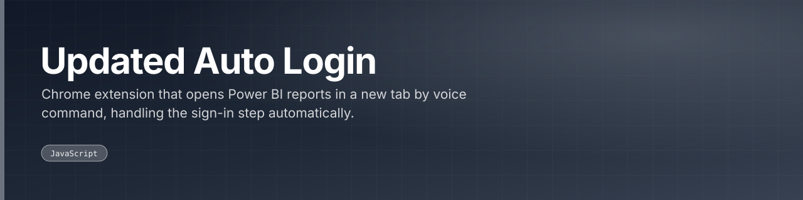

Chrome extension that opens Power BI reports in a new tab by voice command, handling the sign-in step automatically.

 

 

---

## What this is

A voice-driven Chrome extension for Power BI: spoken commands open a report in a new tab, with the login step handled automatically so the dashboard is reachable without typing. The latest of the several MSPL extension iterations in this account.

|  |
|:--:|
| **1** |
| docs |

---

<a href="https://github.com/gowtham-creator/updated-auto-login">gowtham-creator/updated-auto-login</a>

